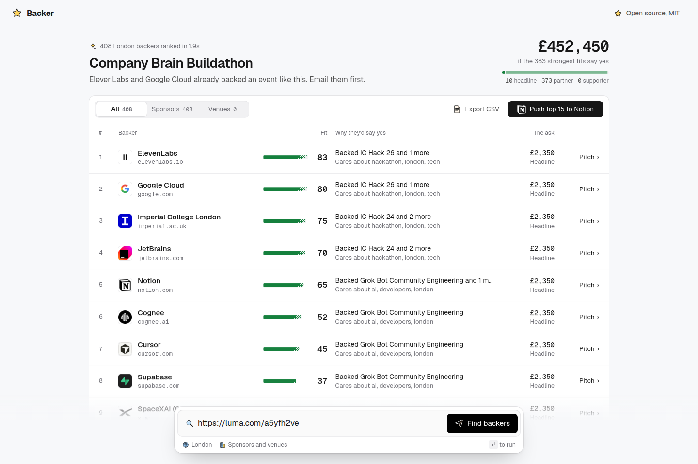
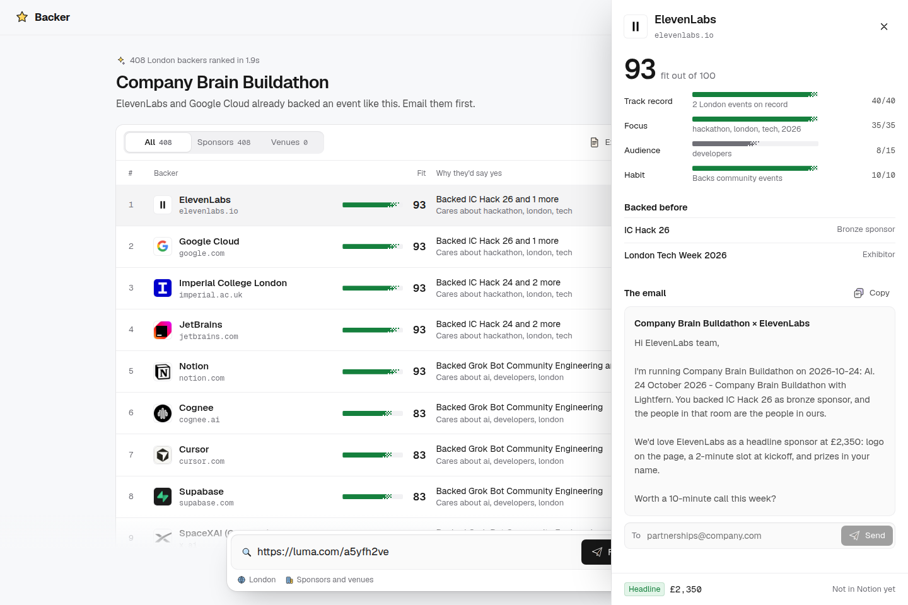

# Demo (3 minutes)

Use a real upcoming London event that is not tonight's hackathon: **Company Brain Buildathon**, Saturday 24 October 2026, https://luma.com/a5yfh2ve.

Already running from `npm install && npm run dev`.

1. **"Every lead here chases sponsors by hand, in spreadsheets and cold DMs."** (15s)
2. Paste `https://luma.com/a5yfh2ve` and press **Find backers**. (15s)
3. Backer ranks the London map. This event returns **408 sponsors** in about 2 seconds. ElevenLabs and Google Cloud backed IC Hack; Imperial and JetBrains backed several Imperial hackathons; Notion backed this community's own hackathon. The line under the title is who to email first. The Venues tab is 0: a venue is included only when the source page linked a real website, and the named venue partner on tonight's page is LinkedIn-only, so it was left out. (60s)
4. Open **ElevenLabs**. The email names IC Hack 26, where they were a bronze sponsor, and asks for **Headline at £2,350**. Copy stays local; nothing is sent until you say so. (45s)
5. Press **Push top 15 to Notion**. That needs `NOTION_TOKEN` plus `NOTION_DATABASE_ID` or `NOTION_PARENT_PAGE_ID` in `.env.local` (create an integration at https://www.notion.so/my-integrations and share the database with it). Without them the button reports `Notion isn't connected yet: add NOTION_TOKEN`. (30s)
6. **"Open source, any community can run it next week."** The header link is the MIT repo. (15s)

