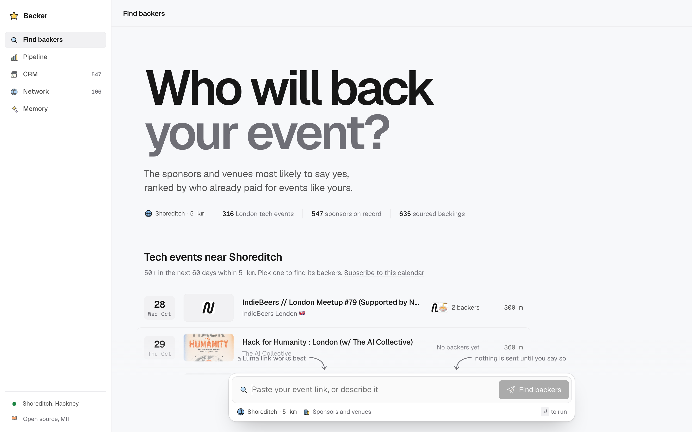
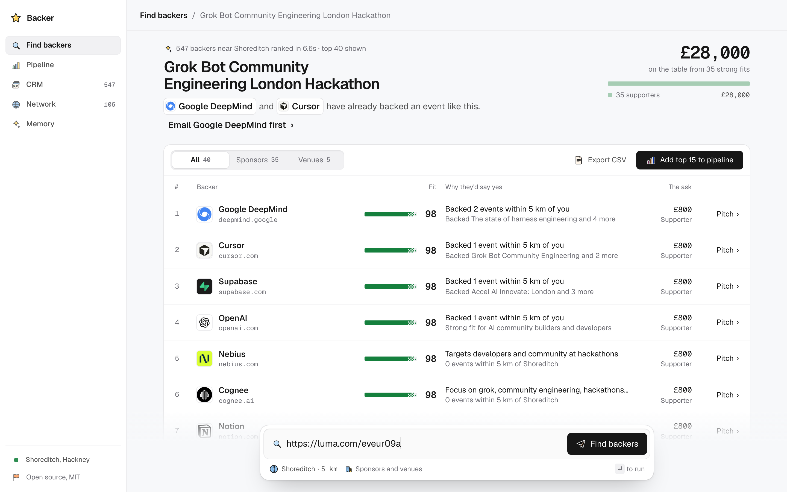
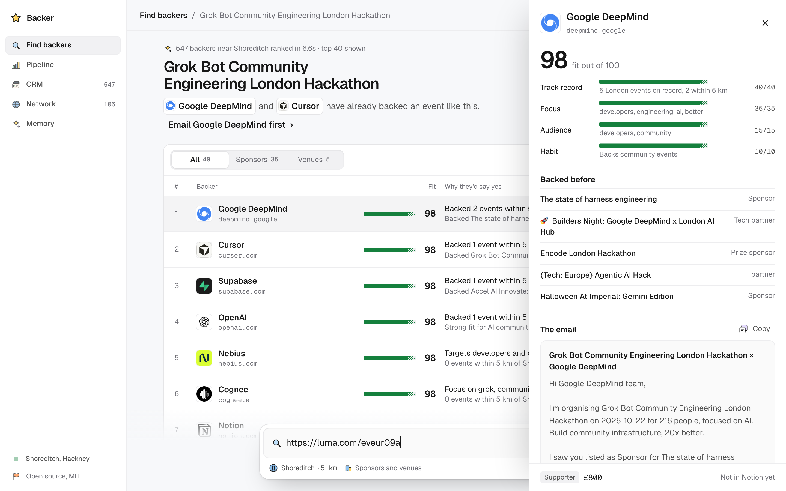
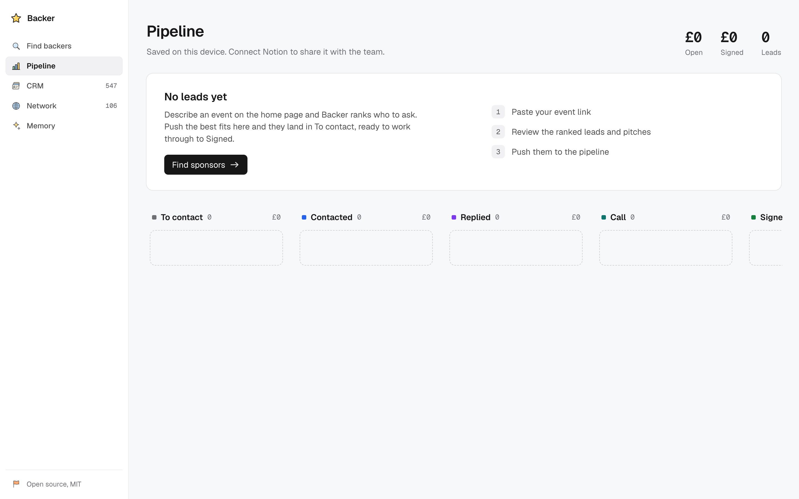
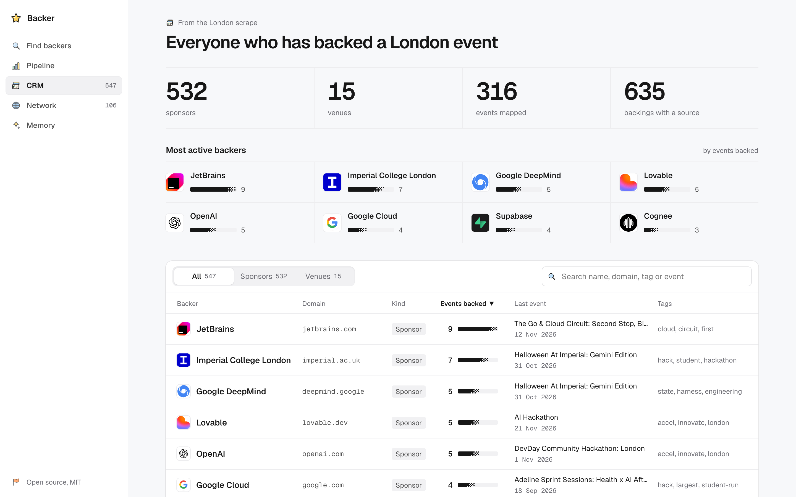
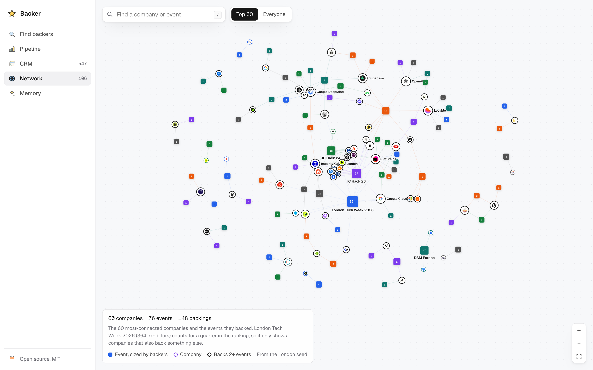

<div align="center">

# Backer

**Paste a London tech event. Get the sponsors and venues most likely to back it, a drafted pitch for each, and a pipeline to chase them.**

[Live demo](https://grokhack.vercel.app) &nbsp;·&nbsp; [For agents](#for-agents-mcp--api) &nbsp;·&nbsp; [Run it](#run-it)

 

<br>



</div>

Event organisers lose weeks working out who might sponsor them. Backer has already read the sponsor sections of hundreds of London tech events, so it can answer from evidence: who backed similar events, in what role, and where we saw it.

Built at the Grok Bot Community Engineering London Hackathon, 22 Oct 2026. Track 5: Front Desk & Revenue.

## What it does

### Find backers

Paste an event URL or describe the event. Backer ranks London sponsors and venues by fit (topic, audience, past backing, distance) and shows why each one is on the list. Every reason points at a real past backing with a source link.



### Lead drafts

Open any lead to get a personal email that names the events that company backed, plus a suggested tier and price. Grok writes the draft and can only cite backings that exist in the map. Send it through Resend, or log a reply when the sponsor answers.



### Pipeline

Leads move through contacted, replied, call and signed on a board, and sync to a Notion database. A repeat push reuses the existing page for the same event and company, so a status you changed by hand is kept.



### CRM

Every sponsor and venue on the map in one table: how many events they backed, the latest one, and every backing with its source link. Open one to draft outreach.



### Company network

The map as a graph: events, sponsors and the backings between them. Companies that backed the same events sit close together, so you can see who your event shares sponsors with. Outreach and replies are layered on top as memory, stored in Supabase and written to [Cognee](https://cognee.ai), which has an "Ask memory" box.



## The map

The value is the data. `data/london.json` is a committed, reproducible map of London tech events, built by `scripts/scrape-events.ts` from ten sources.

| | |
|---|---|
| Events | **316** |
| Sponsors and venues | **547** |
| Backings (sponsor backed event) | **635** |
| Backings with a source URL | **635 of 635** |

**Sources:** Luma, Devpost, Meetup, Eventbrite, BuilderBase, MLH, dev.events, confs.tech, GDG and Hack Club. Each lives in `lib/scrape/sources/` and returns the same `RawEvent` shape. A source that fails is logged and skipped.

**Tech filter.** A classifier keeps London tech events and drops the rest. Measured against hand labels:

| Set | Precision | Recall |
|---|---|---|
| Held-out | 1.00 | 0.93 |
| Fresh | 1.00 | 0.95 |

Reproduce with `node --env-file-if-exists=.env.local --import ./scripts/register.mjs scripts/eval-tech-filter.ts`.

**No invented data.** A sponsor name only counts if it is literally in the page text or the event's own links. Every backing keeps the URL of the page it was read from, and pitches may only mention backings that are in the data. Details in [docs/07-event-scraper.md](docs/07-event-scraper.md).

## Location aware

Tell Backer where you are (GPS or a place search) and it uses that for everything.

- Stored on your device only, in `localStorage`. It is never sent to a server to be saved. Without it, Backer assumes central London.
- Ranking is distance-weighted: a sponsor that keeps backing events near you outranks one that backs equal events across town.
- A nearby events panel lists upcoming events within your chosen radius (2 to 50 km).

## For agents: MCP + API

Backer is readable by other agents, for example Grok Bot. The MCP server is read-only and uses Streamable HTTP.

| Tool | Does |
|---|---|
| `search_events` | Find scraped events by text, date range, upcoming only, or distance from a point |
| `find_backers` | Rank likely sponsors for an event URL or description, with real past backings as reasons |
| `get_sponsor` | One company by domain: kind, tags, and every event it backed with source links |

MCP client config:

```json
{
  "mcpServers": {
    "backer": {
      "url": "https://grokhack.vercel.app/api/mcp"
    }
  }
}
```

REST, same data:

| Route | Query |
|---|---|
| `GET /api/v1/events` | `q`, `lat`, `lng`, `radiusKm`, `from`, `to`, `upcoming`, `limit` |
| `GET /api/v1/backers` | `event` (URL or description), `lat`, `lng`, `radiusKm`, `limit` |
| `GET /api/v1/calendar.ics` | Events as an iCalendar feed to subscribe to |

```bash
curl "https://grokhack.vercel.app/api/v1/backers?event=https://luma.com/your-event&limit=5"
```

If the server sets `BACKER_API_KEY`, send it as `Authorization: Bearer <key>`:

```bash
curl -H "Authorization: Bearer $BACKER_API_KEY" \
  "https://grokhack.vercel.app/api/v1/events?upcoming=1&lat=51.5236&lng=-0.0786&radiusKm=5"
```

## Run it

```bash
npm install
cp .env.example .env.local   # then fill in the keys you have
npm run dev                  # http://localhost:3000
```

Ranking works with no keys at all, because leads come from the committed `data/london.json` (loaded by `lib/seed.ts`). Keys switch on the rest:

| Key | Unlocks |
|---|---|
| `MODEL`, `XAI_API_KEY` | Grok pitch drafts and chat |
| `SUPABASE_URL`, `SUPABASE_SERVICE_ROLE_KEY` | Shared map and memory storage |
| `NOTION_TOKEN`, `NOTION_DATA_SOURCE_ID` | Pipeline sync ([setup guide](docs/04-pipeline-setup.md)) |
| `RESEND_API_KEY`, `RESEND_FROM` | Sending drafts |
| `COGNEE_BASE_URL`, `COGNEE_API_KEY`, `COGNEE_TENANT_ID` | Cognee knowledge graph and "Ask memory" |

Anything unset falls back to the baseline behaviour, so the demo never shows an error.

Refresh the map:

```bash
node --env-file-if-exists=.env.local --disable-warning=MODULE_TYPELESS_PACKAGE_JSON \
  --import ./scripts/register.mjs scripts/scrape-events.ts
```

Flags: `--past`, `--future`, `--limit`, `--only luma,meetup`, `--dry-run`. `XAI_API_KEY` adds a Grok pass that finds partners named in event descriptions.

Check types with `npx tsc --noEmit`. Design and contribution rules are in [AGENTS.md](AGENTS.md); the plan is in [docs/PLAN.md](docs/PLAN.md).

## Stack

| | |
|---|---|
| App | Next.js 16 (App Router, TypeScript) on Vercel |
| Model | Grok via xAI |
| Data | Supabase Postgres, with the committed `data/london.json` as fallback |
| Pipeline | Notion API |
| Memory | Cognee |
| Email | Resend |

## Team

| Area | Owner | Doc |
|---|---|---|
| Scraper (the map) | Jawad | [docs/01-scraper.md](docs/01-scraper.md) |
| Matching and scoring | Avi | [docs/02-matching.md](docs/02-matching.md) |
| Pitch drafts and pricing | Vidit | [docs/03-pitch.md](docs/03-pitch.md) |
| Notion pipeline | Joel | [docs/04-pipeline.md](docs/04-pipeline.md) |
| UI | Dhrishiv | [docs/05-ui.md](docs/05-ui.md) |
| Glue, deploy, demo | Jawad | [docs/06-demo.md](docs/06-demo.md) |
| Event scraper | Avi | [docs/07-event-scraper.md](docs/07-event-scraper.md) |

## License

MIT.
